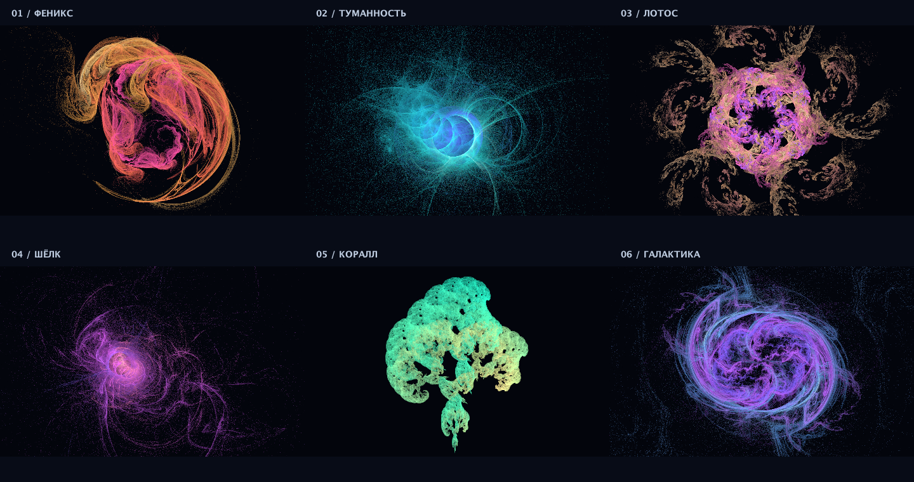

FlameStudio

Учебный проект на Java для создания изображений фрактального пламени. После запуска нужно выбрать один из шести вариантов в консоли. Программа рассчитывает изображение, сохраняет его в PNG и открывает для просмотра.

В проекте используются Java и Gradle. Все вычисления выполняются на процессоре. Готовых библиотек для генерации фракталов нет.

Запуск

Нужен JDK 17 или новее. Открой проект в IntelliJ IDEA как Gradle-проект и запусти Main или конфигурацию Flame Studio. Затем введи число от 1 до 6. Если нажать Enter без числа, будет выбран Феникс.

Из терминала проект запускается командой:

./gradlew --quiet run

На macOS также можно открыть start.command, на Windows — start.bat.

Результат сохраняется в папке renders. Рядом с изображением создаётся конфиг, по которому можно повторить расчёт.

Что можно настроить

Есть шесть пресетов: Феникс, Туманность, Лотос, Шёлк, Коралл и Галактика. Их параметры лежат в папке configs. Можно менять цвета, преобразования, симметрию, размер изображения, число итераций и количество потоков. Обычный размер — 1600 × 1000, максимальный готовый режим — 3840 × 2400.

Например, для изображения высокого качества:

./gradlew --quiet run --args="--preset phoenix --quality high"

Проверка проекта

./gradlew build

При сборке выполняются интеграционные проверки рендера, повторяемости изображений и работы с PNG. В папке .github/workflows есть настройка для запуска той же сборки на GitHub.

Подробная инструкция и описание алгоритма находятся в DOCUMENTATION.txt. Примеры изображений лежат в gallery.
